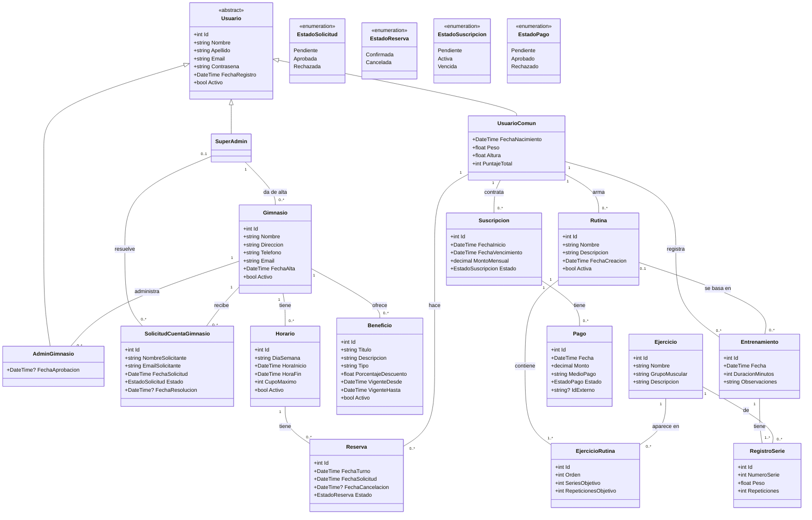

# Diagrama de clases

Diagrama de las entidades de `Domain/Entities`, como quedaron en el código. Lo hicimos con Mermaid para que GitHub lo muestre directo (si no se ve, se puede pegar el bloque en https://mermaid.live).

No pusimos las foreign keys (`GimnasioId`, `RutinaId`, etc.) ni las listas de navegación porque ya se ven en las relaciones.

## Algunas aclaraciones

- `Usuario` es abstracta y las tres clases hijas se guardan en la misma tabla (TPH). EF agrega la columna `Discriminator` para saber de qué tipo es cada fila, y ese mismo nombre de clase es el rol que va en el token.
- `EjercicioRutina` es la clase intermedia entre `Rutina` y `Ejercicio`, porque además de la relación guarda el orden y las series / repeticiones objetivo.
- En `Horario`, `HoraInicio` y `HoraFin` son `DateTime` pero solo se usa la hora. En la API se mandan y se devuelven como texto `HH:mm`.
- `Pago.IdExterno` es el id de la orden en Mercado Pago. Queda en null hasta que se crea la orden.
- Las bajas de gimnasios, horarios, beneficios y rutinas son lógicas (`Activo` / `Activa` en false). Los entrenamientos sí se borran.
